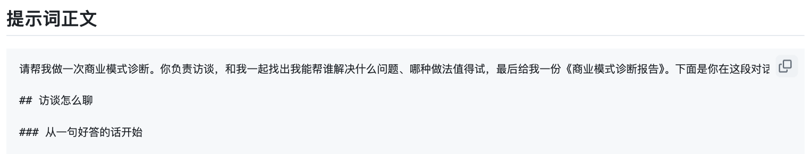

# 陈大lin 的 AI 工具

手里有点本事，想靠它接一单，却说不清别人会为什么付钱？可以先花二十分钟，和 AI 聊聊最近有人找你帮过的一个忙。已经有产品、正在做内容或跟进客户，也可以直接挑下面对应的工具。

## 第一次来？先在你平时用的 AI 里试一次

1. 打开[商业模式诊断提示词](skills/dl-benshi-interview/提示词-通用版.md#提示词正文)，点「提示词正文」下方灰色框右上角的复制按钮（两张纸的图标）。
2. 打开你平时用的 AI（比如 DeepSeek），新建一个对话，粘贴并发送。它会从一件你做过的小事问起，打字或语音回答都行。
3. 举个例子，如果你上周帮朋友整理了几十张旅行照片，就讲讲他当时卡在哪、你是怎么帮的。聊完，你会拿到一份《商业模式诊断报告》，里面写着可以先帮谁做什么、报价怎么试、第一步找谁验证。

想先看一轮问答，或想知道怎么读报告、下次怎么接着聊，可以看[商业模式诊断教程](skills/dl-benshi-interview/README.md)。

## 按你现在要做的事选工具

| 你想做什么 | 用完能拿到什么 | 从这里开始 |
| --- | --- | --- |
| 找出自己的优势，试着接第一单 | 把你的经历、可试的产品、客户和工时放在一起看的诊断报告 | [商业模式诊断](skills/dl-benshi-interview/README.md) |
| 有个亲身经历，想写成一条口播或一篇笔记 | AI 先采访你，再用你的原话整理成稿 | [访谈式内容深挖](skills/dl-content-deepdive/README.md) |
| 收藏了几篇小红书笔记，想知道它们怎么写 | 一份能在浏览器看的拆解报告，和下次写稿能继续用的写作指南 | [小红书笔记拆解](skills/dl-xhs-benchmark/README.md) |
| 手里有一批小红书私信名单，想知道哪些人还需要跟进 | 去重的名单、客户核查结果，以及能接着处理的跟进记录 | [小红书私信跟进](skills/dl-xhs-winback/README.md) |

## 在自己的电脑上用

**用 Codex 或 Claude Code**，打开[安装指南，跟着做完第一轮](docs/安装指南.md)。四个工具可以单独下载，挑你要用的那个就行。[下载最新安装包](https://github.com/DalinChen255/dl-skill/releases/latest)

**做小红书笔记拆解**，需要 Python 3.9 或更新版本，以及 TikHub 的数据接口，取数可能产生费用。**做小红书私信跟进**，需要支持浏览器控制的 Codex Desktop。它的教程从虚构名单开始，第一次练习就能看到结果，全程发送零条消息。

## 版本与发布

想知道这次改了什么，看[版本记录](https://github.com/DalinChen255/dl-skill/releases)。维护仓库时，按[命名、测试与发布说明](CONTRIBUTING.md)更新首页、各工具教程和安装包。

个人使用和学习免费。公开发布衍生作品请注明来源，商业用途请联系作者单独授权。[许可证](LICENSE)
