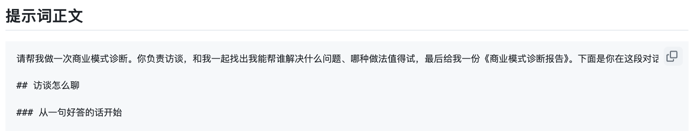

# 选一个工具，装好后试第一轮

如果你只想聊聊自己能卖什么，打开[商业模式诊断提示词](../skills/dl-benshi-interview/提示词-通用版.md#提示词正文)，点灰色正文框右上角两张纸的图标，把复制的内容发到平时用的 AI。手机也可以点。若应用内打不开复制按钮，用系统浏览器打开同一页再点。



想让 AI 在自己的电脑上读文件、存稿子或生成网页报告，再按下面的步骤安装。

## 用 Codex

1. 打开 Codex，选一个你打算用来做这件事的项目文件夹。点下表的一个「下载 ZIP」，把下载好的压缩包放进这个项目。
2. 在该项目的对话里发送下面这句话。Codex 会帮你解压、放到工具目录，并检查文件是否齐全。

   ```text
   我刚把一个 dl- 开头的工具 ZIP 放进了这个项目。请按压缩包的名字（去掉 .zip），把它安装到本项目 .agents/skills/ 下的同名目录。如果该目录已有文件，先告诉我。装好后检查 SKILL.md 和 README.md 在这个工具目录的第一层，告诉我完整路径。
   ```

3. 在同一项目新开对话，从下表最后一列复制一句话发给 Codex。第一次问答或自检成功后，点左边的工具教程继续。

如果浏览器已经自动解压，把整个同名文件夹放进项目的 `.agents/skills/` 即可。以诊断工具为例，放好后能在 `.agents/skills/dl-benshi-interview/` 里看到 `SKILL.md`。

| 工具 | 下载到电脑 | 装好后可以这样说 |
| --- | --- | --- |
| [商业模式诊断](../skills/dl-benshi-interview/README.md) | [下载 ZIP](https://github.com/DalinChen255/dl-skill/releases/latest/download/dl-benshi-interview.zip) | 用商业模式诊断帮我找找我能卖什么，从最近一次别人找我帮忙的事问起。 |
| [内容深挖](../skills/dl-content-deepdive/README.md) | [下载 ZIP](https://github.com/DalinChen255/dl-skill/releases/latest/download/dl-content-deepdive.zip) | 用内容深挖访谈，帮我把第一次摆摊的经历写成口播。先采访我。 |
| [小红书笔记拆解](../skills/dl-xhs-benchmark/README.md) | [下载 ZIP](https://github.com/DalinChen255/dl-skill/releases/latest/download/dl-xhs-benchmark.zip) | 用小红书笔记拆解工具分析几篇收藏的笔记。先告诉我需要准备什么，等我确认了再取数。 |
| [小红书私信跟进](../skills/dl-xhs-winback/README.md) | [下载 ZIP](https://github.com/DalinChen255/dl-skill/releases/latest/download/dl-xhs-winback.zip) | 使用 `$dl-xhs-winback` 运行工具自带的离线自检，只用虚构示例，不打开私信通，告诉我结果。 |

私信跟进用 Codex Desktop 打开上面选的项目。离线自检通过后，再按教程打开自己已登录的私信通，先做只读核对。其余三个工具也可以装在个人目录 `~/.agents/skills/`，供多个 Codex 项目使用。

## 用 Claude Code

商业模式诊断、内容深挖、小红书笔记拆解都可以安装为 Claude Code 插件。先在电脑的终端里运行下面一行，把这个仓库添加到插件市场。

```bash
claude plugin marketplace add DalinChen255/dl-skill
```

然后**只运行你需要的那一行**。三行依次对应商业模式诊断、内容深挖、小红书笔记拆解。

```bash
claude plugin install dl-benshi-interview@dl-skill
claude plugin install dl-content-deepdive@dl-skill
claude plugin install dl-xhs-benchmark@dl-skill
```

运行 `claude plugin list`，看到刚安装的工具已启用，重新打开 Claude Code，发送上表里对应的第一句话。也可以把解压后的整个工具文件夹放进 `~/.claude/skills/` 来手动安装。

## 卡在哪一步

- **不知道下载哪一个。** 上表的四个下载链接会直接下载单个工具。版本发布页里的 `Source code` 是整套仓库的源码。
- **Codex 识别不到。** 让它列出项目里的 `.agents/skills/`。正常的路径形如 `.agents/skills/dl-benshi-interview/SKILL.md`。如果连续出现两层 `dl-benshi-interview`，把解压位置调整到只剩一层，再开新对话。
- **Claude 以前添加过这个市场。** 用 `claude plugin marketplace update dl-skill` 刷新列表。已经装过诊断插件时，再运行 `claude plugin update dl-benshi-interview@dl-skill` 并重启。其他插件换成相应的名字。
- **笔记拆解提示缺少 Token。** 安装完成后还要为 TikHub 配置自己的密钥。打开[笔记拆解教程](../skills/dl-xhs-benchmark/README.md)，在本机完成配置。
